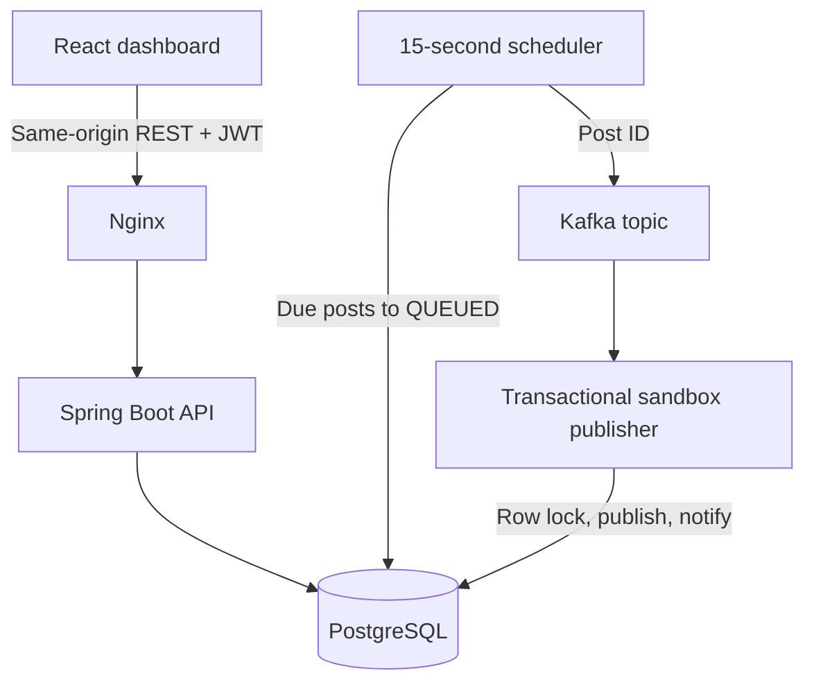

# SocialFlow

A complete local full-stack social media workspace for Experiments **3.3.1 and 3.3.2**. Built with React, Redux Toolkit, Tailwind CSS, Spring Boot, PostgreSQL, JWT, Kafka, and Docker.

## Start in one command

Install **Docker Desktop with Docker Compose v2**, start Docker, and extract this ZIP. On Windows, use Linux containers and enable WSL2 if Docker requests it. Open a terminal in the extracted `SocialFlow` folder:

```sh
docker compose up --build -d
```

Alternatively double-click `start.bat` on Windows, or run `sh start.sh` on macOS/Linux. The first build downloads dependencies and images; allow several minutes and roughly 4–6 GB free memory. Internet is required for this initial build.

- Application: **http://localhost:3000**
- API health: **http://localhost:8080/api/health**
- Swagger / OpenAPI: **http://localhost:8080/swagger-ui/index.html**
- Status: `docker compose ps`
- Logs: `docker compose logs -f backend`
- Stop, retaining data: `docker compose down`

| Account | Password | Permissions |
|---|---|---|
| `admin@socialflow.local` | `SocialFlow123!` | All content + manage team |
| `editor@socialflow.local` | `SocialFlow123!` | Create, edit, delete, schedule, publish, comment |
| `viewer@socialflow.local` | `SocialFlow123!` | Read content, calendar, analytics, comments |

All accounts belong to **one shared workspace**. This is not a tenant-isolated SaaS service. PostgreSQL persists data across restarts. Seed data is inserted only when the members table is empty. Copy `.env.example` to `.env` to customize local passwords and JWT secret before the first start. Changing the demo password later does not reset existing accounts.

## What works

- JWT sign-in, one-hour expiry, logout; BCrypt password hashing.
- Server-enforced role permissions; role changes take effect immediately for existing sessions.
- Create, edit, delete, and filter posts; draft, schedule, publish-now workflows.
- Monthly calendar with navigation, daily details, scheduling and local timezone display.
- Kafka publishing pipeline with durable database queue, retries, and idempotent consumption.
- Charts, date range filters, summaries and CSV export derived from database records.
- Team account creation, role management, per-post comments, per-user notification read state.
- Responsive layouts, accessible form labels, keyboard modal navigation, dark/light theme.
- Automatic refresh every five seconds, loading feedback, validation and error handling.
- Flyway migrations, Swagger, Docker health checks, CI test/coverage gate and image publication.

**Publishing and analytics scope:** Publishing is a clearly labeled **local sandbox**. The consumer marks posts published and creates notifications; it does not send to Instagram, LinkedIn or X. Seeded engagement metrics are realistic sample data, not downloaded platform metrics. New published posts start at zero impressions and engagements. Real integrations need platform OAuth, approved scopes, media processing, provider-specific publishing/analytics adapters and credential management. No pretend connected accounts or fabricated live metrics are used.

## Try the end-to-end workflow

1. Sign in as admin and create a teammate with Editor or Viewer access.
2. Create a post, save as draft, locate it under Content, and add a comment.
3. Edit it, select a future local date/time and press Schedule.
4. Open Calendar and select that date. The post appears in the day details.
5. When due, the scheduler queues it; Kafka delivers it to the sandbox publisher, normally within 15–30 seconds.
6. The post becomes Published. A notification appears and the charts reflect its stored metrics.
7. Sign in as Viewer to check read-only access. An attempted direct write API call returns 403.
8. Change an Editor's role while they are signed in; server permissions change immediately and the interface updates on refresh.

The schedule field uses browser local time and is converted to an ISO timestamp. The database stores timezone-aware timestamps. A queued post is locked against editing/deletion; after publication it may be deleted but not edited.

## Architecture



The `posts` table doubles as a durable publishing outbox. If Kafka delivery fails, the QUEUED row stays eligible for the next dispatch. The consumer locks the row and changes it only if it is still QUEUED. Duplicate messages therefore do not duplicate notifications. If a scheduled update races with publication, row locks ensure only a valid transition succeeds. Kafka storage is ephemeral in this local Compose setup; PostgreSQL queue state is authoritative and pending posts are resent after broker restart. Processing is at least once, with idempotent **local database** effects. Real external publishing would require an idempotency key or reconciliation against the provider.

Analytics use stored post metrics and publishing timestamps, not client-generated totals. Deleting a published post also removes its contribution to analytics. Charts use database-day grouping; the calendar displays local time. The notification feed displays the latest 50 entries; marking all read covers the entire feed for the current user.

## Source layout

```text
SocialFlow/
  frontend/src/       React dashboard, Redux session, API client, utilities, styles
  frontend/nginx.conf   SPA routing, API proxy, login throttling, security headers
  backend/src/main/java/com/socialflow/
    Application.java    Boot entrypoint and OpenAPI metadata
    Security.java       JWT verification and stateless security
    Api.java            REST workflows, validation and authorization
    Publishing.java     Kafka dispatcher and idempotent consumer
    Seed.java           Demo workspace and sample records
    Errors.java         Safe API error responses
  backend/src/main/resources/db/migration/  Versioned database schema
  backend/src/test/     HTTP integration and publishing retry tests
  .github/workflows/ci.yml  Tests, coverage, image builds, optional deploy hook
  compose.yaml         Local PostgreSQL, Kafka, backend, frontend
```

## API guide

Call `POST /api/auth/login` with:

```json
{"email":"admin@socialflow.local","password":"SocialFlow123!"}
```

Copy the returned `token` and send `Authorization: Bearer TOKEN`. Swagger's **Authorize** button accepts the raw token.

| Method | Route | Purpose |
|---|---|---|
| GET | `/api/health` | Public process health |
| GET | `/api/me` | Current member and role |
| GET / POST | `/api/posts` | List / create posts |
| PUT / DELETE | `/api/posts/{id}` | Update / delete post |
| GET / POST | `/api/posts/{id}/comments` | Read / add team comments |
| GET | `/api/analytics?days=30` | Summary, daily series, channel totals; 1–365 days |
| GET / POST | `/api/team` | List members / create local member account |
| PATCH | `/api/team/{id}` | Change another member's role |
| GET | `/api/notifications` | Latest 50 workspace notifications, personal read state |
| POST | `/api/notifications/read` | Mark notifications read for current user |

Post payload:

```json
{
  "title": "Our next chapter",
  "body": "We are building something new. #BuildTogether",
  "channel": "LinkedIn",
  "status": "DRAFT",
  "scheduledAt": null
}
```

Allowed channels: `Instagram`, `LinkedIn`, `X`. Write status: `DRAFT`, `SCHEDULED`, `QUEUED` (publish now). `PUBLISHED` is set only by the consumer. A scheduled post requires a future ISO-8601 datetime such as `2027-05-20T12:00:00Z`. Validation errors use 400, bad login 401, forbidden actions 403, missing records 404, and state conflicts 409.

## Development and tests

Docker is sufficient to run the app; local Node/Java installs are optional. For development, install Java 17+, Maven 3.9+, and Node 22+.

```sh
cd backend
mvn verify
# coverage report: target/site/jacoco/index.html

cd ../frontend
npm ci
npm test
npm run build
```

Backend tests use an H2 database in PostgreSQL compatibility mode and mock the Kafka transport. They exercise authentication, roles, validation, CRUD, comments, analytics, notification read isolation, retries and duplicate consumption. `mvn verify` enforces **at least 80% aggregate backend line coverage**, without excluding application classes. Frontend utility tests cover filtering, calendar dates, timezone input and CSV escaping. This is not a claim of 80% browser/component coverage.

For a full running-stack integration check, run `python scripts/smoke.py` after Docker starts. It checks frontend serving, authentication, persistence, comments and actual Kafka scheduling/publication, then deletes its test post. CI also runs this smoke test against Docker.

To iterate on the frontend while Docker serves the API:

```sh
cd frontend
npm ci
npm run dev
```

Open the Vite URL printed in the terminal. Vite proxies `/api` to localhost:8080. For backend development, use Compose's existing internal PostgreSQL and Kafka through a local port-forward override, or run the backend inside Compose with `docker compose up --build -d backend`. Avoid pointing a locally running backend at the container-only hostname `kafka`.

## CI/CD and deployment

Push the **contents of SocialFlow/** as the repository root. GitHub Actions runs `mvn verify`, frontend tests/build, validates Compose, uploads the coverage report, and publishes versioned frontend/backend images to GHCR on `main`. Enable package write access for the repository's workflow token. For actual deployment, configure an HTTPS deployment hook in repository secret `DEPLOY_HOOK_URL` and set repository variable `DEPLOY_ENABLED=true`; the target service must already be configured to deploy this repository/images with PostgreSQL and Kafka. No external deployment is performed by this ZIP.

This is a working educational foundation, **not a security-audited public production service**. Before public deployment: replace demo credentials and JWT secret; require TLS; put backend behind the trusted reverse proxy; add account recovery/password rotation, refresh-token revocation, audit retention, robust distributed rate limiting, tenant isolation if needed, monitoring and backups; use managed PostgreSQL and multi-broker Kafka with TLS/auth; add provider integrations and production load/security/browser testing. The included single-node broker, polling, small shared dataset, and in-process batch dispatcher target local experiments. Access tokens live in sessionStorage and expire after one hour; signing out removes the local token but does not revoke a copied token before expiry.

## Troubleshooting

- **Docker not running / elevation or WSL error:** Start Docker Desktop; finish its WSL2/Linux container setup and restart if prompted.
- **Port already in use:** Edit the localhost ports `3000` or `8080` in Compose. Update the Vite API proxy only when doing frontend development against a changed API port.
- **First build seems slow:** Follow `docker compose logs -f`; dependencies are downloaded during the first build. Check internet access and Docker's memory allocation.
- **Post stays queued:** Check `docker compose logs kafka backend`. Rows survive broker outages and retry every 15 seconds.
- **Old demo password:** Seeding does not overwrite persisted users. Use the password configured when the database was first initialized.
- **429 on login:** Too many attempts; wait a minute. Frontend Nginx limits login attempts. The localhost-only direct API port is for development and bypasses that proxy limit.
- **Reset all demo data (destructive):** `docker compose down -v` then `docker compose up --build -d`. This deletes the PostgreSQL volume.

Technology references: [Spring Boot requirements](https://docs.spring.io/spring-boot/3.5/system-requirements.html), [Kafka Docker quickstart](https://kafka.apache.org/39/getting-started/quickstart/).
